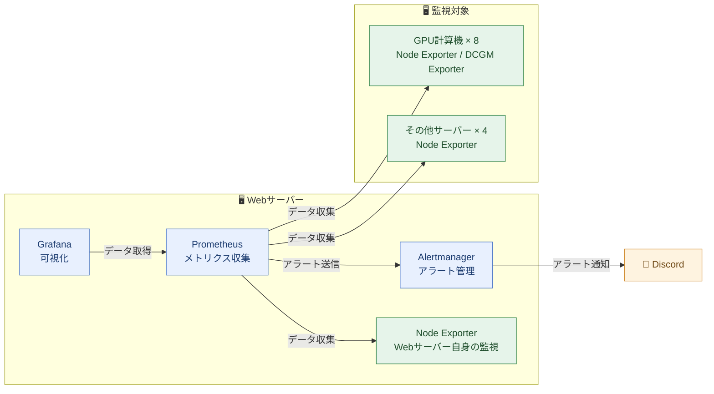

## はじめに

私が所属する組織では10台以上のサーバーを運用しており、私はその管理を担当しています。

監視基盤を作るきっかけは、メンバーと「どのサーバーを使っているか」を話したことでした。
いつも同じサーバーの名前が挙がるため、利用が集中しているサーバーと、あまり使われていないサーバーがあるのではないかと感じました。
しかし、その時点では全体の使用状況を把握できていませんでした。

そこで、各サーバーのリソース使用状況を確認できる監視基盤を構築しました。
本記事では、その構成に加え、利用者の要望を取り入れた改善や、アラートを運用する中で見えてきた課題を紹介します。

## 前提

私の組織のサーバー構成は以下の通りです。

| 種類 | 台数 | 備考 |
| --- | --- | --- |
| GPU計算機 | 8台 | 実験・学習用 |
| Webサーバー | 1台 | 監視基盤（Prometheus、Grafana、Alertmanager）を設置 |
| その他サーバー | 4台 | LDAP、踏み台など |

監視基盤はWebサーバー上に構築し、Webサーバー自身を含む13台からメトリクスを収集します。

## 監視基盤の構成

Prometheusで各サーバーのメトリクスを収集し、Grafanaで可視化します。
アラートはAlertmanagerで管理し、Discordに通知する構成にしました。

### 全体構成

全体像は以下の通りです。



### リソース使用状況の可視化

各サーバーのCPUやメモリ、ディスク、GPUなどの使用状況を、Grafanaのダッシュボードで確認できるようにしました。


### アラート

ダッシュボードを常に確認することは難しいです。
そこで、リソース使用率が設定したしきい値に達した際などに、Discordへアラートを通知するようにしました。

アラートは重要度に応じて、以下の2つのDiscordチャンネルに通知します。

- 上位アラート：サーバー管理者のチャンネル
- 下位アラート：times

設定したアラートは以下の通りです。

| 項目 | 下位アラート | 上位アラート |
| --- | --- | --- |
| Node Exporterとの疎通 | - | 疎通できない |
| DCGM Exporterとの疎通 | - | 疎通できない |
| CPU使用率 | 80% | 90% |
| メモリ使用率 | 80% | 90% |
| Swap使用率 | 60% | 90% |
| ディスク使用率 | 80% | 90% |

Discordには以下のように通知されます。


:::message
本記事ではドメインをダミーのものに差し替えています。
:::

## 技術スタック

### Node Exporter

各サーバーのCPU、メモリ、ディスクなどのメトリクスを公開するために使用しています。
Webサーバー自身のリソース監視にも使用しています。

https://github.com/prometheus/node_exporter

### DCGM Exporter

GPU計算機のGPU使用率やGPUメモリ使用量、温度、消費電力などを取得するために使用しています。

https://docs.nvidia.com/datacenter/cloud-native/gpu-telemetry/latest/dcgm-exporter.html

### Prometheus

各Exporterからメトリクスを定期的に収集し、時系列データとして保存しています。
また、アラート条件を評価し、条件を満たすとAlertmanagerへアラートを送信します。

https://prometheus.io/docs/introduction/overview/

### Grafana

Prometheusに保存したデータを可視化し、各サーバーのリソース使用状況を確認するために使用しています。
GPUの監視には、自作のダッシュボードを使用しています。

https://grafana.com/docs/grafana/latest/introduction/

### Alertmanager

Prometheusから受け取ったアラートを、重要度に応じて通知先へ振り分けています。
上位アラートの発生中に、重複する下位アラートの通知を抑えるためにも使用しています。

https://prometheus.io/docs/alerting/latest/alertmanager/

### Discord Webhook

AlertmanagerからDiscordのチャンネルへ通知を送るために使用しています。

https://docs.discord.com/developers/resources/webhook

### Docker

Node Exporter、DCGM Exporter、Prometheus、Grafana、Alertmanagerは、すべてDockerコンテナとして動かしています。
Webサーバーでは、もともと組織のWebサイトやGitLab、リバースプロキシのNginxなどをコンテナで運用していたため、監視基盤もそれにそろえました。

### Ansible

Ansibleは、もともと各サーバーへのDockerのインストールに使用していました。
今回は、Node Exporter / DCGM Exporterの設置・設定も自動化しました。
複数台に同じ設定をまとめて適用し、手作業の負担や設定ミスを減らすことが目的です。

さらに、本記事で構成を説明し、他の方にも使ってもらいやすくするため、公開用のコードにはPrometheus、Alertmanager、Grafanaなどを構築するロールも追加しています。

https://docs.ansible.com/ansible/latest/getting_started/introduction.html

## 工夫した点

### 利用者の要望を受けてGPU監視を追加した

最初はNode Exporterで監視を始めました。
メンバーに監視できるようになったことを報告し、追加で確認したい情報を聞いたところ、GPUも監視したいという要望がありました。
そこで、DCGM Exporterを導入しました。

ダッシュボードについては、`nvidia-smi`で確認できる情報を網羅した既存のものが見つからなかったため、自作しました。
さらにメンバーに使ってもらうと、「全サーバーのGPUの状態を一度に確認したい」という意見がありました。
その意見をもとに、全サーバーのGPU使用状況を一覧で確認できるように改善しました。

詳しくは以下の記事にまとめています。

https://zenn.dev/hayate_k/articles/0222fdfdfc9af4

### AnsibleでExporterの導入を自動化した

Webサーバーを除く12台にExporterを手作業で設置・設定するのは手間がかかり、設定ミスも起こりえます。
そこで、AnsibleでNode ExporterとDCGM Exporterの設置・設定を自動化しました。

公開用のコードは以下のリポジトリにまとめています。

https://github.com/HayateKato/Server-Monitoring-with-Ansible

## 運用で直面した問題と対策

### Dockerコンテナによるホスト情報の取得

ExporterをDockerコンテナで動かす際には、ホストの情報を取得するうえで以下の課題がありました。

- ノード名がコンテナのハッシュ値になります。
- ディスク情報が取れません。

詳しくは以下の記事にまとめています。

https://zenn.dev/hayate_k/articles/ce6ca3a26908ad

### アラートの通知量

当初は、対応の必要性や通知の重複を十分に考慮できていませんでした。
そのため、アラートが頻繁に届き、かえって不便になってしまいました。
通知量を減らすために、次の対策を行いました。

#### 対策1. 重複する通知を抑える

たとえばディスク使用率では、同じサーバーで90%のアラートが発生している間、80%のアラートの通知を抑えるようにしました。
`equal: ['instance']`を指定することで、同じサーバーのアラートだけを抑制対象にしています。

```yaml
inhibit_rules:
  # ディスク使用率90%のアラート中は80%のアラートを抑制
  - source_matchers:
      - alertname="HighDiskUsage-90%"
      - severity="critical"
    target_matchers:
      - alertname="HighDiskUsage-80%"
      - severity="warning"
    equal: ['instance']
```

https://prometheus.io/docs/alerting/latest/configuration/

#### 対策2. アラート条件の見直し

アラートが出ても、実際には対応しないケースがありました。
たとえばSwap使用率30%の段階では特に対応していなかったため、この条件のアラートは削除しました。

## 役立った場面

### 利用が集中しているサーバーを特定できた

ある計算機サーバーで、ディスク使用率90%のアラートが出ました。
利用者にデータの削除をお願いしたものの、数日後には再び同じアラートが出ました。

調べてみると、特定の1人だけでなく、複数人がそれぞれ多くのディスク容量を使っていました。
また、同じサーバーではCPUやメモリのアラートも頻繁に出ていました。
一方、ダッシュボードで他のサーバーと比較すると、新しく導入されたサーバーの中には、ほとんど使われていないものがありました。

この状況から、特定の利用者の使いすぎではなく、利用者が同じサーバーに集中していることが原因だと考えました。
そこで、新しいサーバーへ移るよう呼びかけたところ、元のサーバーではディスク使用率90%のアラートが出なくなり、新しいサーバーも使われるようになりました。

監視を始めたきっかけである利用の偏りを、実際の使用状況から確認し、対処につなげられました。

### サービスに支障が出る前に異常に気づけた

Webサーバーのメモリ使用率が80%程度、Swap使用率が60%程度の状態で、3日ほど推移していることに気づきました。
GitLabの処理によって一時的に高くなることはありましたが、今回は長期間続いていたため、普段とは異なる状態だと判断しました。

`ps aux --sort=-%mem`でメモリ使用量の多いプロセスを確認すると、GitLabのPuma workerプロセスが12個動作し、多くのメモリを使用していました。
そこで、worker数を4個に減らし、各workerのメモリ使用量が1024MBを超えた際に再起動するよう、Pumaの設定を変更しました。

```ruby
puma['worker_processes'] = 4
puma['per_worker_max_memory_mb'] = 1024
```

設定を変更した後、GitLabコンテナ内で`gitlab-ctl reconfigure`を実行して反映しました。
その後、worker数が4個に減り、メモリとSwapの使用量も減ったことを確認しました。

GitLab自体は動作していましたが、普段とは異なる使用状況に気づいたことで、サービスに支障が出る前に対処できました。

## 学んだこと

監視基盤を運用して、アラートは「通知を受けた人がどう行動するか」まで考えて設計する必要があると学びました。
しきい値を超えたことを一律に通知するだけでは、対応しない通知が増えてしまいます。
対応の必要性や重要度に応じて、アラート条件と通知先を整理することが重要でした。

また、利用者の声を取り入れることで、必要な機能や見せ方を改善できました。
GPU監視の追加や一覧表示への改善は、メンバーの要望がきっかけでした。
自分だけで必要なものを決めず、実際に使ってもらいながら改善することの大切さも学びました。

## 今後の改善案

### 対応につながっていない下位アラートの見直し

計算機のCPU・メモリの下位アラートには、通知されても対応していないものが残っています。
大きなモデルを動かすと、すぐにしきい値に達するためです。

Swap使用率30%のアラートは削除しましたが、通知条件の見直しはまだ十分ではありません。
通常の利用で発生する通知についても、対応が必要かどうかを踏まえて整理していきたいです。

### アラートに対応する担当者の明確化

アラートへの対応が自分に集中していることも課題です。
現在は、通知を受けたときに誰が対応するかが決まっていません。

改善案として、通知時にサーバー管理者の中からランダムに1人をメンションする仕組みを考えています。
誰が対応するのかを明確にし、他の管理者も対応できる運用にしていきたいです。

### サーバーを移りやすくする仕組み

利用の偏りには、新しいサーバーへ移る手間も関係しています。
以前から使っているサーバーにデータや実験環境があると、移動の負担が大きくなります。

NASによるデータ共有や、Dockerによる実験環境の整備で、移動の手間を減らせるかもしれません。
利用状況の可視化に加えて、空いているサーバーを使いやすくする仕組みも検討したいです。

## おわりに

サーバーの利用が偏っているのではないかという疑問から、監視基盤を構築しました。
使用状況を可視化したことで、利用の偏りへの対処や、サービスに支障が出る前の異常の発見につながりました。

一方で、通知を出すだけでは対応につながらないことも分かりました。
今後は、残っているアラート条件の見直しや担当者の明確化に取り組み、監視で得た情報を日々の運用に生かせるよう改善していきたいです。
