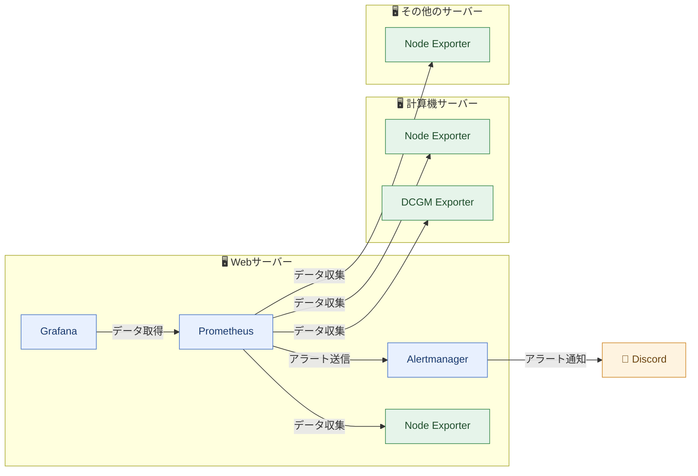
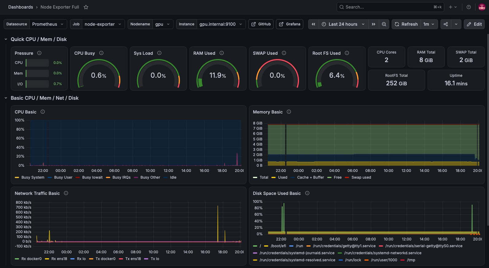
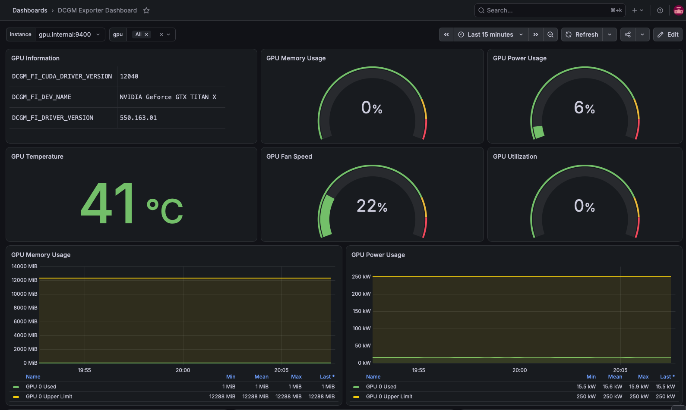
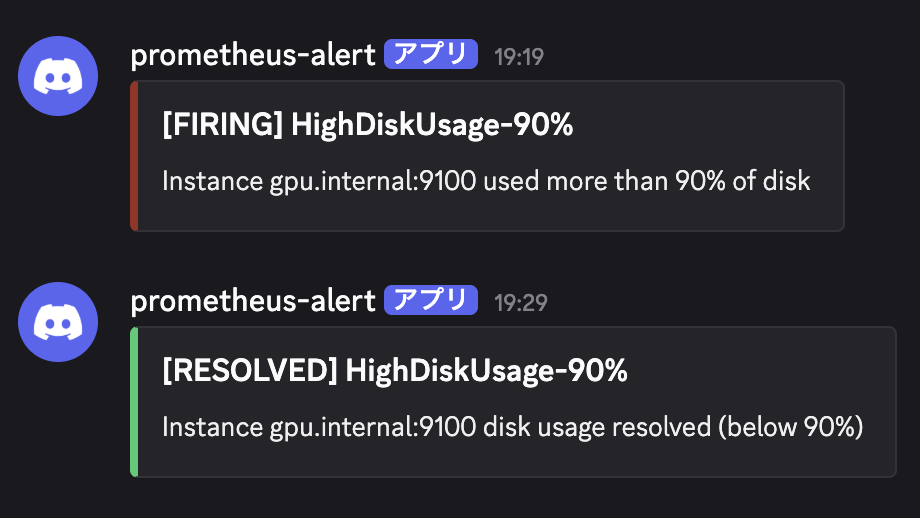

## はじめに

私が所属する組織では13台のサーバーを運用しており、私はその管理を担当しています。

あるとき、組織の他のメンバーとの間で「普段どのサーバーを使っているか」が話題になりました。
話を聞くと、いつも同じサーバーの名前ばかりが挙がり、私はサーバーの利用に偏りがあるのではないかと感じました。
ただ、当時は組織で運用しているすべてのサーバーの使用状況を確認する手段がなく、それが本当かどうか確かめられませんでした。

そこで、各サーバーのリソース使用状況を確認できる監視基盤を構築しました。
本記事では、監視基盤の構成に加え、メンバーからの要望を取り入れた改善や、監視基盤を運用する中で見えてきた課題を紹介します。

## 前提

組織で運用しているサーバーの構成は以下の通りです。

| 種類 | 台数 | 用途 |
| --- | --- | --- |
| 計算機サーバー | 8台 | 機械学習 |
| Webサーバー | 1台 | WebサイトやGitLab等のWebサービス |
| その他のサーバー | 4台 | LDAP、踏み台など |

監視基盤はWebサーバー上に構築しており、Webサーバー自身を含む13台のリソース使用状況を確認できるようにしています。

## 監視基盤の構成

監視基盤の全体像は以下の通りです。
なお、これは現在の構成で、DCGM Exporterは運用開始後にメンバーからの要望を受けて追加したものです。



### 各コンポーネントの役割

#### Node Exporter

各サーバーのCPU、メモリ、ディスクなどのリソース使用状況を、Prometheusが収集できる形式のデータとして公開するために使用しています。
監視基盤を動かしているWebサーバー自身にも設置しています。

https://github.com/prometheus/node_exporter

#### DCGM Exporter

計算機サーバーのGPU使用率やGPUメモリ使用量、温度、消費電力などを、Prometheusが収集できる形式のデータとして公開するために使用しています。

https://docs.nvidia.com/datacenter/cloud-native/gpu-telemetry/latest/dcgm-exporter.html

#### Prometheus

各Exporterからデータを定期的に収集し、時系列データとして保存しています。
また、アラート条件を評価し、条件を満たすとAlertmanagerへアラートを送信します。

https://prometheus.io/docs/introduction/overview/

#### Grafana

Prometheusからデータを取得し、各サーバーのリソース使用状況を可視化するために使用しています。

https://grafana.com/docs/grafana/latest/introduction/

#### Alertmanager

Prometheusから受け取ったアラートを、重要度に応じて通知先へ振り分けています。

https://prometheus.io/docs/alerting/latest/alertmanager/

#### Discord Webhook

AlertmanagerからDiscordのチャンネルへアラート通知を送るために使用しています。

https://docs.discord.com/developers/resources/webhook

### その他

#### Docker

Node Exporter、DCGM Exporter、Prometheus、Grafana、Alertmanagerは、すべてDockerコンテナとして動かしています。
Webサーバーでは、もともと組織のWebサイトやGitLabなどをDockerコンテナで運用していたため、監視基盤もそれにそろえました。

#### Ansible

組織では、もともとDockerのインストールやファイアウォールの設定などにAnsibleを使っていました。
Exporterの設置・設定もAnsibleを使えば13台にまとめて行えると考え、Ansibleを採用しました。

https://docs.ansible.com/ansible/latest/getting_started/introduction.html

## 監視基盤でできること

### リソース使用状況の可視化

以下のように、各サーバーのリソース使用状況をGrafanaのダッシュボードで確認できるようにしました。





### アラート通知

ダッシュボードは自分から見に行かないと異常に気づけず、普段は他の作業もあるため常に確認し続けることはできません。
そこで、リソース使用率がしきい値を超えたときや、Exporterと疎通できなくなったときに、Discordへアラートを通知するようにしました。

設定したアラートは以下の通りです。
なお、これらは後述する見直しを反映した現在の設定です。

| 項目 | 下位アラート | 上位アラート |
| --- | --- | --- |
| Node Exporterとの疎通 | - | 疎通できない |
| DCGM Exporterとの疎通 | - | 疎通できない |
| CPU使用率 | 80% | 90% |
| メモリ使用率 | 80% | 90% |
| Swap使用率 | 60% | 90% |
| ディスク使用率 | 80% | 90% |

アラートは重要度に応じて、以下の2つのDiscordチャンネルに通知しています。

- 上位アラート（`critical`）：サーバー管理者のチャンネル
- 下位アラート（`warning`）：times

Discordには以下のように通知されます。



:::message
本記事ではドメインをダミーのものに差し替えています。
:::

## 工夫した点

### メンバーの要望を受けたGPU監視機能の追加

最初はNode Exporterを使って各サーバーのCPU、メモリ、ディスクなどのリソース使用状況のみを監視していました。
私はメンバーにリソース使用状況を監視できるようになったことを報告し、追加で確認したい情報を聞いたところ、GPUの状態も見られるようにしたいという要望がありました。
そこで、GPUを監視するためにDCGM Exporterを導入しました。

ダッシュボードについては、NVIDIAのGPU状態確認コマンドである`nvidia-smi`で確認できる情報を網羅した既存のものが見つからなかったため、自作しました。
自作したダッシュボードをメンバーに使ってもらうと、「全サーバーのGPUの使用状況を一度に確認したい」という要望がありました。
その要望を受けて、全サーバーのGPU使用状況を一覧で確認できるよう、追加でダッシュボードを作成しました。

詳しくは以下の記事にまとめています。

https://zenn.dev/hayate_k/articles/0222fdfdfc9af4

### AnsibleによるExporterの設置・設定の自動化

13台すべてにExporterを手作業で設置・設定するのは手間がかかり、設定ミスも起こりえます。
そこで、AnsibleでNode ExporterとDCGM Exporterの設置・設定を自動化しました。

公開用のコードは以下のリポジトリにまとめています。
他の方にも使ってもらいやすくするため、公開用のコードにはPrometheus、Alertmanager、Grafanaなどを構築するロールも追加しています。

https://github.com/HayateKato/Server-Monitoring-with-Ansible

## 運用で直面した問題と改善

### Dockerコンテナからのサーバー情報の取得

ExporterをDockerコンテナで動かす際には、コンテナを動かしているサーバー自身の情報を取得するうえで以下の課題がありました。

- Node Exporterが出力するホスト名（`nodename`）がコンテナIDになる
- ディスク情報が取れない

これらの課題への対応策は、以下の記事にまとめています。

https://zenn.dev/hayate_k/articles/ce6ca3a26908ad

### アラートの通知量

監視基盤の運用を始めると、アラート通知が頻繁に届き、ノイズになってしまいました。
振り返ると、アラートを設定する際に、通知の重複や対応の必要性を十分に考慮できていませんでした。
そこで、不要な通知の量を減らすために次の改善を行いました。

#### 改善1. 重複する通知を抑制する

例えば、ディスク使用率では、同じサーバーで90%のアラートが発生している間、80%のアラートの通知を抑制するようにしました。
監視対象のサーバーを識別するラベルである`instance`を`equal: ['instance']`で指定することで、通知を抑制する対象を同じサーバーのアラートに限っています。

```yaml
inhibit_rules:
  # ディスク使用率90%のアラート中は80%のアラートを抑制
  - source_matchers:
      - alertname="HighDiskUsage-90%"
      - severity="critical"
    target_matchers:
      - alertname="HighDiskUsage-80%"
      - severity="warning"
    equal: ['instance']
```

アラートの抑制の設定方法は、以下の公式ドキュメントで確認できます。

https://prometheus.io/docs/alerting/latest/configuration/

#### 改善2. アラート条件の見直し

アラートが通知されても、サーバー管理者が実際には対応しないケースがありました。
例えば、当初はSwap使用率が30%を超えた時点でアラートを通知していました。
しかし、Swap使用率30%程度ではサーバーの動作に影響がなかったため、サーバー管理者は通知を受けても対応していませんでした。
そのため、この条件のアラートは削除し、Swap使用率が60%、90%をそれぞれ超えたときのみアラートを通知するようにしました。

## 役立った場面

### 利用が集中しているサーバーの特定

ある計算機サーバーで、ディスク使用率90%のアラートが通知されました。
そこで、ディスク使用量の多い上位3人に、不要なデータの削除か外付けHDDへの移動をお願いしました。

しかし後日、ディスク使用率は99%に達していました。
依頼したメンバーの中にはデータを減らしてくれた人もいましたが、別のメンバーの使用量が増えていました。
特定の1人だけでなく、複数のメンバーがそれぞれ多くのディスク容量を使っている状況でした。
また、このサーバーでは、他の計算機サーバーと比べてCPUやメモリのアラートが特に多く発生していました。
一方、ダッシュボードで他の計算機サーバーの使用状況と比較すると、新しく導入されたサーバーの中には、ほとんど使われていないものがありました。

この状況から、特定のメンバーの使いすぎではなく、メンバーが同じサーバーに集中していることが原因だと考えました。
そこで、改めてデータの削除をお願いするとともに、何人かに他のサーバーへ移ってもらうよう呼びかけました。
その結果、元のサーバーではディスク使用率に関するアラートが発生しなくなり、新しいサーバーも使われるようになりました。

監視基盤を構築したきっかけであるサーバーの利用の偏りを、実際の使用状況から確認し、対処につなげることができました。

### サービスに支障が出る前の異常の発見

WebサーバーのSwap使用率60%のアラートが数日続けて通知されました。
ダッシュボードで確認すると、メモリ使用率が70%程度、Swap使用率が65%程度の状態で、3日ほど推移していました。
以前から、GitLabの処理によってメモリ使用率とSwap使用率が一時的に高くなることはありましたが、今回は長期間続いていたため、普段とは異なる状態だと判断しました。

原因を調査したところ、GitLabのプロセスが多くのメモリを使っていたため、GitLabの設定を見直してメモリ使用量を抑えました。

GitLab自体は動作していましたが、アラートとダッシュボードで普段とは異なる使用状況に気づけたことで、サービスに支障が出る前に対処できました。

## 学んだこと

監視基盤を運用してみて、アラートは「通知を受けた人がどう行動するか」まで考えて設計する必要があると学びました。
しきい値を超えたことを一律に通知するだけでは、対応しない通知が増えてしまいます。
対応の必要性に応じてアラート条件を絞り、重複する通知を抑制することが重要でした。

また、GPU監視の追加や、全サーバーのGPU使用状況を一覧で確認できるダッシュボードの作成は、メンバーの要望がきっかけでした。
自分だけで必要なものを決めず、実際に使ってもらいながら改善することの大切さを学びました。

## 今後の改善案

### 対応につながっていない下位アラートの見直し

計算機サーバーのCPU・メモリの下位アラートは、通知されても対応していないのが現状です。
大きなモデルを動かすとすぐにしきい値に達するため、通常の利用でも頻繁に通知されてしまいます。
対応が必要な状況かどうかを踏まえて、通知条件を見直していきたいです。

### アラートに対応する担当者の明確化

アラートへの対応が自分に集中していることも課題です。
現在は、通知を受けたときに誰が対応するかが決まっていません。

改善案として、通知時にサーバー管理者の中からランダムに1人をメンションする仕組みを考えています。
誰が対応するのかを明確にし、他のサーバー管理者も対応できる運用にしていきたいです。

### サーバーを移りやすくする仕組み

サーバーの利用の偏りには、新しいサーバーへ移る手間も関係しています。
以前から使っているサーバーにデータや実験環境があると、移動の負担が大きくなります。

そこで、NASによるデータ共有やDockerによる実験環境の整備により、移動の手間を減らせないか考えています。
利用状況を可視化するだけでなく、空いているサーバーを使いやすくすることで、サーバーの利用の偏りを減らしていきたいです。

## おわりに

サーバーの利用に偏りがあるのではないかという疑問から、監視基盤を構築しました。
監視基盤でサーバーのリソース使用状況を可視化し、アラートを通知したことで、サーバーの利用の偏りへの対処や、サービスに支障が出る前の異常の発見につながりました。

一方で、通知を出すだけでは対応につながらないことも分かりました。
今後は、残っているアラート条件の見直しや担当者の明確化、サーバーを移りやすくする仕組みづくりに取り組み、監視で得た情報を日々の運用に生かせるよう改善していきたいです。
