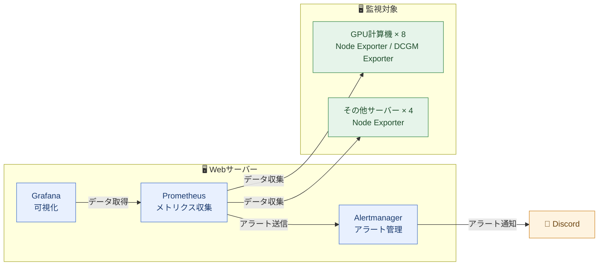

## はじめに

私が所属する組織では10台以上のサーバーを並行運用しており、私はその管理を担当している。
ある時、組織の仲間とどのサーバーを使っているか話した時、みんないつも同じサーバーばかり使っている気がした。
もしかすると常に忙しいサーバーと暇なサーバーがあるのでは？と感じた。
また、そもそも「10台以上あるのに、全体の様子を把握している人がいなかった」とも感じた。
以上から、各サーバーのリソースが普段どの程度使われているのか興味が湧いた。
そこで、監視基盤を構築し、使用量をリアルタイムに観測できるようにした

## 本記事のゴール

完成後の全体像



### リソース使用状況の可視化

各サーバーのリソース使用状況を、Grafanaのダッシュボードで以下のように見れるようにする

<Node Exporterの写真>

<DCGM Exporterの写真>

### アラート

ダッシュボードを常に確認するわけではない。
リソース使用率が高くなった際にアラート通知を出し、それで気づけるようにする。

アラートは重要度に応じて、以下の2つのDiscordチャンネルに通知する。

- 上位アラート：サーバー管理者のチャンネル
- 下位アラート：times

設定したアラートは以下の通り。

| 項目 | 下位アラート | 上位アラート |
| --- | --- | --- |
| Node Exporterとの疎通 | - | 疎通できない |
| CPU使用率 | 80% | 90% |
| メモリ使用率 | 80% | 90% |
| Swap使用率 | 60% | 90% |
| ディスク使用率 | 80% | 90% |

例として、ディスク使用率90%のアラートルールは以下の通り。

```yaml
- alert: HighDiskUsage-90%
  expr: 100 - (node_filesystem_avail_bytes{mountpoint="/"} * 100 / node_filesystem_size_bytes{mountpoint="/"}) > 90
  for: 5m
  labels:
    severity: critical
    channel: task-infrastructure
  annotations:
    firing_text: "Instance {{ $labels.instance }} used more than 90% of disk"
    resolved_text: "Instance {{ $labels.instance }} disk usage is below 90%"
```

- `for: 5m`で、閾値を超えた状態が5分続いたときだけ発火させ、一時的な増加では通知しないようにしている
- `channel`ラベルで、通知先のチャンネルを指定している

Alertmanagerでは、この`channel`ラベルをもとに通知先を振り分けている。

```yaml
route:
  receiver: 'default'
  group_by: ['alertname', 'instance', 'severity', 'channel']
  group_wait: 30s
  group_interval: 5m
  repeat_interval: 1d
  routes:
    # 上位アラート：サーバー管理者のチャンネル
    - matchers:
        - channel="task-infrastructure"
      receiver: 'critical-alert'
    # 下位アラート：times
    - matchers:
        - channel="alert"
      receiver: 'warning-alert'
```

https://prometheus.io/docs/alerting/latest/configuration/

discordへの通知は以下のようにされる。

<discordへの通知の写真>

## 前提

私の組織のサーバー構成は以下の通り。

| 種類 | 台数 | 備考 |
| --- | --- | --- |
| GPU計算機 | 8台 | 実験・学習用 |
| Webサーバー | 1台 | 監視基盤（Prometheus、Grafana、Alertmanager）を設置 |
| その他サーバー | 4台 | LDAP、踏み台など |

監視基盤はWebサーバー上に構築し、他のサーバーからメトリクスを収集する。

## 技術スタック

### Node Exporter

- Prometheus公式が提供する、ハードウェアとOSのメトリクスを公開するExporter
- CPU、メモリ、ディスク、ネットワーク、ファイルシステムなどの使用状況を取得できる

https://github.com/prometheus/node_exporter

### DCGM Exporter

- NVIDIAが提供する、GPUのメトリクスを公開するExporter
- NVIDIA DCGM（Data Center GPU Manager）から情報を取得し、Prometheusが読める形式で公開する
- GPUの稼働率、GPUメモリ使用量、温度、消費電力などを取得できる

https://docs.nvidia.com/datacenter/cloud-native/gpu-telemetry/latest/dcgm-exporter.html

### Prometheus

- 監視・アラートツール
- 監視対象のExporterへ定期的にアクセスし、メトリクスを収集する（pull型）
- 収集したデータは時系列データとしてローカルに保存される
- PromQLというクエリ言語でデータを取り出せる
- ルールを設定すると、条件を満たした際にAlertmanagerへアラートを送れる

https://prometheus.io/docs/introduction/overview/

### Grafana

- メトリクスやログを可視化するツール
- Prometheusなどをデータソースとして登録し、グラフやダッシュボードを作成できる
- コミュニティが公開しているダッシュボードをインポートして使うこともできる

https://grafana.com/docs/grafana/latest/introduction/

### Alertmanager

- Prometheusから送られたアラートを処理し、通知するツール
- 似たアラートを1件にまとめる（グルーピング）、内容に応じて通知先を振り分ける（ルーティング）、重大なアラート発生中は関連する通知を止める（抑止）などの機能を持つ
- メールやSlack、Discordなど、さまざまな通知先に送信できる

https://prometheus.io/docs/alerting/latest/alertmanager/

### Discord Webhook

- Discordのチャンネルにメッセージを投稿するための仕組み
- Botユーザーや認証を用意せずに使える

https://docs.discord.com/developers/resources/webhook

### Docker

Discord Webhookを除く上記のツールは、すべてDockerコンテナとして動かしている。
Webサーバーでは、もともと組織のWebサイトやGitLabなどのサービスをコンテナで運用していたため、監視基盤もそれにそろえた。

## 工夫した点

### 1. メンバーの要望を聞き、GPU監視を追加し、ダッシュボードを改善する

- Node Exporterで監視できるようになったことを報告し、追加で確認したい情報を聞いた
- GPUも監視したいという要望を受け、DCGM Exporterを導入した
- nvidia-smiで確認できる情報を網羅した既存のダッシュボードが見つからなかったため、自作した
- メンバーに使ってもらったところ、「全サーバーのGPUの状態を一度に確認したい」という意見があった
- その意見をもとに、全サーバーのGPUの使用状態を一覧で確認できるようにダッシュボードを改善した

詳しくは以下の記事

https://zenn.dev/hayate_k/articles/0222fdfdfc9af4

### 2. Exporterの設置・設定をIaC化する

Webサーバーを除く12台のサーバーに手作業で設置・設定するのは大変である。
また、手作業でやると設定を間違える可能性もある。
そのため、AnsibleでNode / DCGM Exporterの設置・設定を自動化した。

実際に作ったレポジトリは以下
<レポジトリ>

## 大変だった点

### Dockerコンテナによるホスト情報の取得

以下の課題があった。

- ノード名がコンテナのハッシュ値になる．
- ディスク情報が取れない．
- 再起動の要否の情報が取れない．

詳しくは以下の記事

https://zenn.dev/hayate_k/articles/ce6ca3a26908ad

### アラートの通知量

対応の必要性や通知の重複を十分に考慮できておらず、アラートが頻繁に届き、逆に不便になった

#### 対策1. 重複する通知を抑える

上位アラートが発生している間は、下位アラートを通知しないようにした。
`equal: ['instance']`により、同じサーバーで両方のアラートが出ているときだけ抑制される。

```yaml
inhibit_rules:
  # ディスク使用率90%のアラート中は80%のアラートを抑制
  - source_matchers:
      - alertname="HighDiskUsage-90%"
      - severity="critical"
    target_matchers:
      - alertname="HighDiskUsage-80%"
      - severity="warning"
    equal: ['instance']
```

https://prometheus.io/docs/alerting/latest/configuration/

#### 対策2. アラート条件の見直し

アラートが出ても対応しないことがあった。
Swap使用率30％では特に対応しないため、そのアラートを削除した。

## 役立った場面

### 使用サーバーの偏りがわかった

- ある計算機サーバーで、ディスク使用率90%のアラートが出たので、データの削除をお願いした
- 削除してもらったが、数日後にまた同じアラートが出た
- サーバーを調べると、特定の1人ではなく、複数人がそれぞれ多くのディスクを使っていた
- 同じサーバーで、CPUやメモリのアラートも頻繁に出ていた
- ダッシュボードで他のサーバーと比べると、新しく導入されたサーバーの中には、ほとんど使われていないものがあった
- 誰か1人の使いすぎではなく、そのサーバーを使う人が多すぎることが原因だと考えた
- 新しく導入されたサーバーへ移るよう、利用者に呼びかけた
- その結果、そのサーバーでアラートが出なくなり、新しいサーバーも使われるようになった

### サービスに支障が出る前に異常を発見し、対処できた

- Webサーバーのメモリ・Swap使用率が、3日ほど高い状態（60%くらい）で推移していることに気づいた。
- GitLabの処理によって一時的に高くなることはあったが、今回は長期間続いていたため、通常とは異なる状態だと判断した。
- 原因を調べたところ、Pumaのworkerプロセスが大量に発生していることが分かった。
- GitLab自体は動作していたが、監視によって異常の兆候を把握し、サービスに支障が出る前に対処できた。

## 学んだこと

- アラートは、通知を受けた人がどう行動するかまで考えて設計することが重要
    - 閾値を超えたことを一律に通知するのではなく、対応の必要性や重要度に応じて、アラート条件・通知の受け取り方を整理する必要があると学んだ。
- 利用者の声を取り入れることで、本当に必要な機能の追加や見せ方の改善ができる
    - 自分だけで必要な機能を判断せず、要望を聞いて機能を追加し、実際に使ってもらいながら改善することが重要だと学んだ。

## 改善案

### 対応していない下位アラートがある

- 計算機のCPU、メモリ、Swapの下位アラートが出ても対応していない
- 大きなモデルを動かすと、すぐに下位アラートのしきい値に達するから
 
### 自分以外のサーバー管理者が対応してくれない

- 「私が対応するだろう」と思われ、他の管理者がアラートに対応してくれない
- アラート通知時に、サーバー管理者の中からランダムに1人をメンションし、担当者を明確にする

### サーバーの偏りを解消する仕組み

- 前から使っているサーバーから、新しいサーバーへ移るのが面倒という課題がある
- NASによるデータの共有や、Dockerによる実験環境の整備が効くかもしれない

## 終わりに
